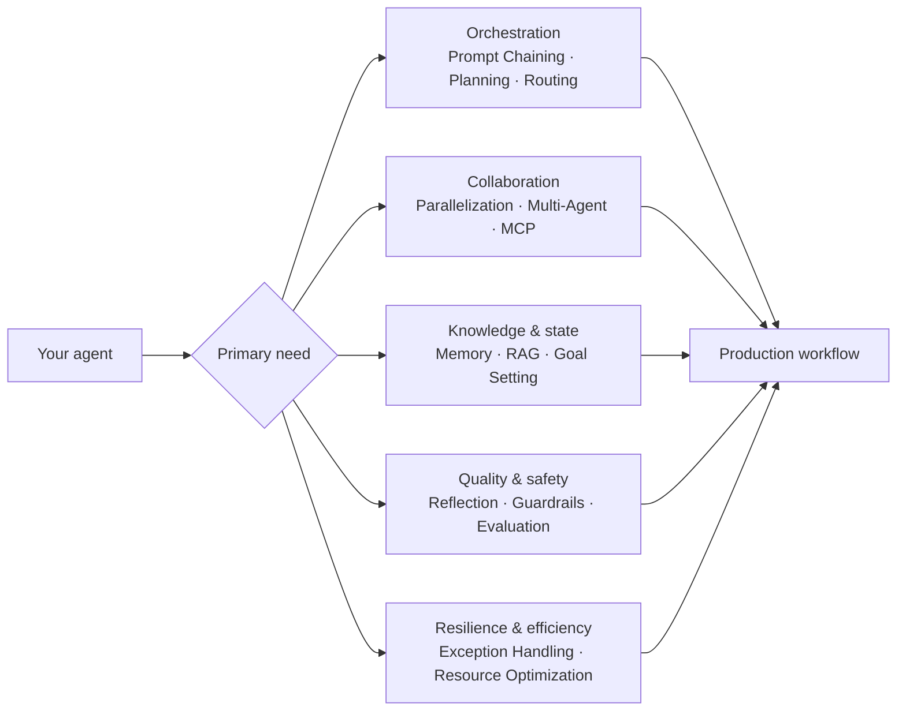

# Agentic design-pattern map

Use this map to choose a starting point. Patterns are intentionally small and composable: begin with one need, then follow the suggested combinations.

## Recommended combinations

| Goal | Start with | Add next |
| --- | --- | --- |
| Build a trustworthy knowledge assistant | RAG | Guardrails, Evaluation, Memory |
| Automate multi-step work | Prompt Chaining | Planning, Exception Handling |
| Serve varied user requests | Routing | Tool Use, Human-in-the-Loop |
| Coordinate specialist agents | Multi-Agent | Inter-Agent Communication, Evaluation |

Each pattern directory contains its implementation and a focused explanation. The examples are learning-oriented reference implementations; validate security, evaluation criteria, costs, and provider limits before deploying them in production.
